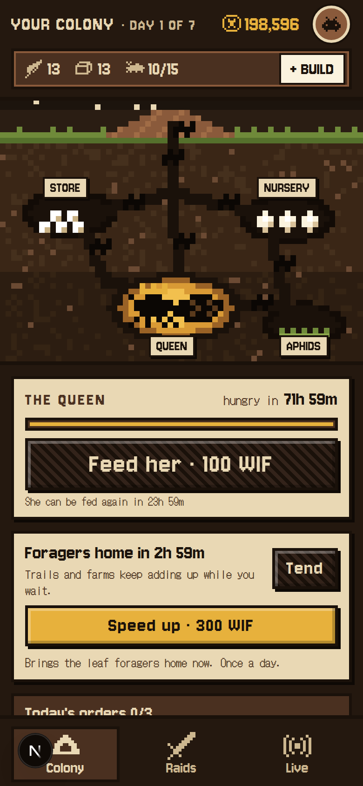
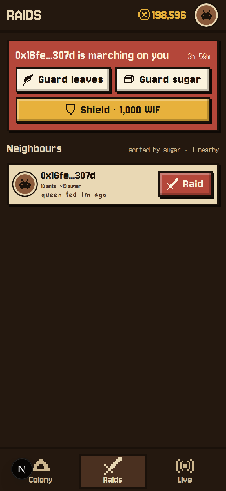
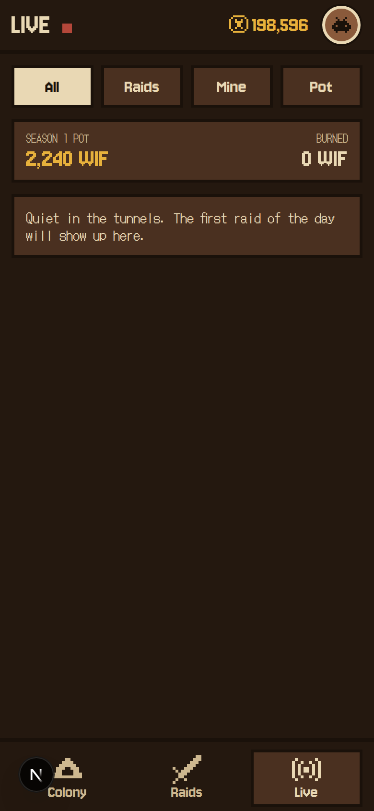
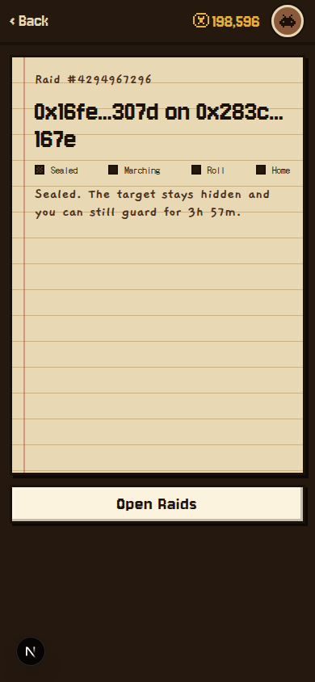
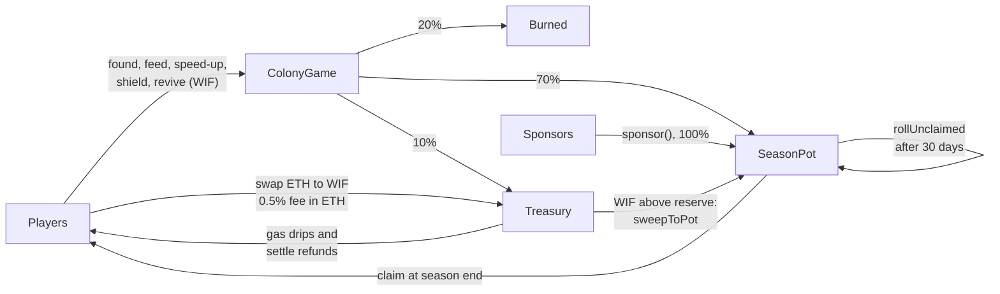
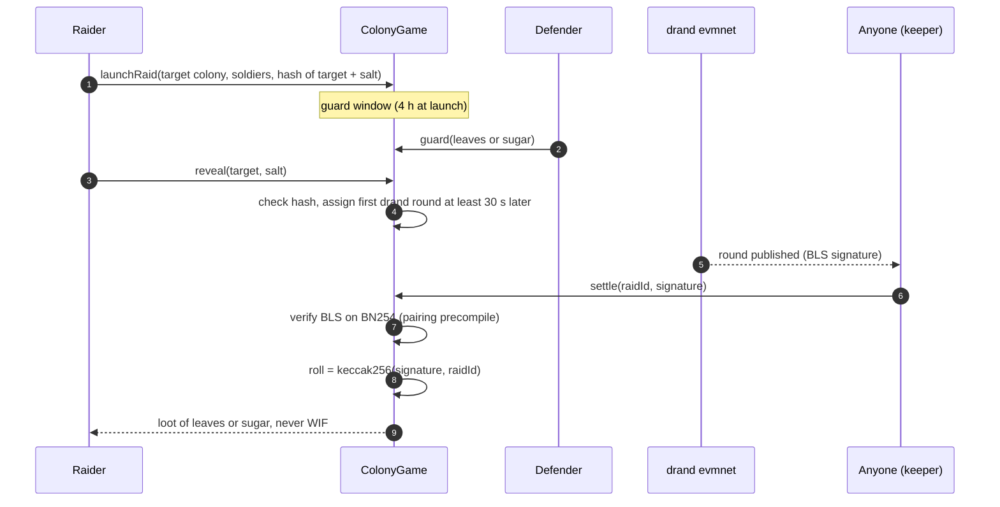
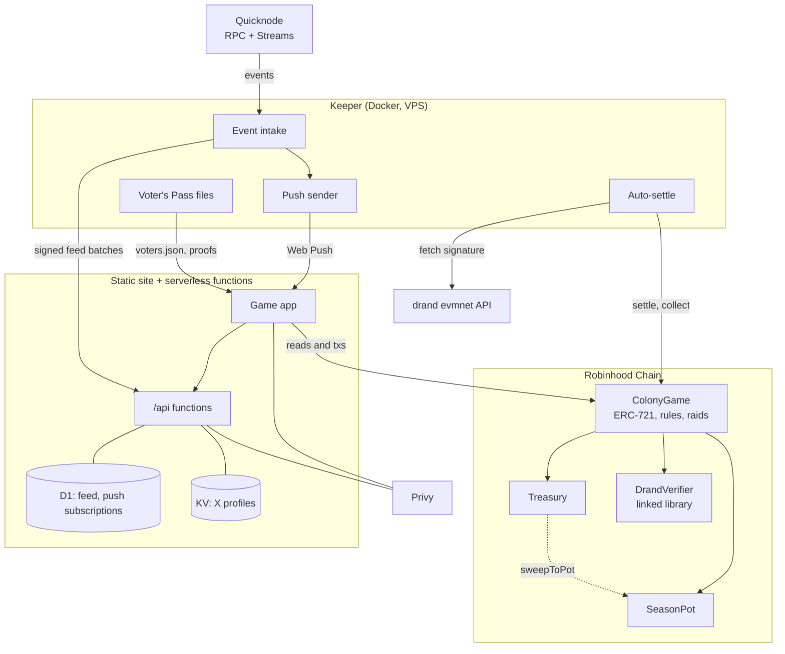

<p align="center"></p>

<p align="center"><b>An onchain ant-colony strategy game on Robinhood Chain, played and paid in $WIF.</b></p>

<p align="center">
  <a href="https://c0lony.xyz">c0lony.xyz</a> (landing) ·
  <a href="https://app.c0lony.xyz">app.c0lony.xyz</a> (the game)
</p>

> The "0" in C0LONY is a zero, not the letter O. In URLs it is lowercase: `c0lony`.

Built for the World is Flat hackathon. Every paid action spends WIF, raid outcomes come from drand randomness verified onchain, and the season prize pot can only ever be paid to players.

| Colony | Raids | Live | Raid report |
| --- | --- | --- | --- |
|  |  |  |  |

_Screenshots are from the Robinhood Chain testnet deployment._

## Contents

[What it is](#what-c0lony-is) · [Why WIF](#why-wif-is-needed) · [Flywheel](#the-flywheel) · [Raids and randomness](#raids-and-randomness) · [Features](#features) · [Voter's Pass](#voters-pass) · [Architecture](#architecture) · [Contracts](#contracts) · [How to play](#how-to-play) · [Testing](#testing) · [After the hackathon](#after-the-hackathon) · [Repo and docs](#repo-layout)

## What C0LONY is

You run an ant colony. A season lasts up to 21 days (7 by default). The daily loop:

1. **Tend** the colony: collect leaves and sugar from forage, trails and farms.
2. **Feed the queen** (WIF plus 3 leaves) at least once every 72 hours or she starves. Each feeding grows the colony and adds score.
3. **Build**: dig chambers, lay leafcutter trails, grow aphid farms, assign workers.
4. **Raid** neighbours for leaves and sugar, and guard against raids on you.
5. **Season end**: the WIF pot is shared among colonies that stayed alive, by score.

Raids never move WIF. They only move leaves, sugar and soldiers.

## Why WIF is needed

Every paid action costs WIF, and 70% of each payment goes straight into the season pot, so playing grows the prize and the burn.

| Action | Launch price | With Voter's Pass |
| --- | --- | --- |
| Found a colony | 1,500 WIF | 1,200 WIF |
| Feed the queen | 100 WIF | 80 WIF |
| Speed up a hand forage | 300 WIF | |
| Shield (no new raids for 8 h) | 1,000 WIF | |
| Revive a starving queen | 2,000 WIF + 20 per worker | |

> **Prices are not final.** The owner can tune every price within hard caps in the contract (0.25x to 4x the launch value) and every change emits an event. Expect them to move as the WIF price moves and the game is balanced. The values above are from `ColonyGame.launchConfig()`.

Players without WIF can swap ETH for WIF inside the app (KyberSwap aggregator, `robinhood` route). A 0.5% fee on that swap is paid in ETH to the Treasury.

## The flywheel



- **Split:** every WIF payment is split 70% pot, 20% burned (`WIF.burn`), 10% Treasury, in the same transaction. ColonyGame never keeps WIF.
- **Payout:** a colony qualifies if it was fed at least twice and its queen was fed within 72 h of the season end. Half of the pot is shared by score among all qualifying colonies. The other half is shared by score among the top 25% of them.
- **Ranking is checked, not trusted:** anyone (the keeper in practice) submits the ranked list in batches and `SeasonPot` verifies the strict order, so only one correct ranking can be accepted.
- **The owner can withdraw Treasury funds (ETH and WIF), but never pot funds.** Treasury withdrawals emit events. The pot has no owner and no withdraw function: WIF leaves it only through `claim` (to a qualifying player) and `rollUnclaimed` (into a later season's pot, 30 days after payout opens).
- **Sponsors:** anyone can add WIF to the current or a future season's pot, with a name.

## Raids and randomness

A raid is a sealed bet. The raider commits to a target resource without revealing it, the defender may guess and guard, and the outcome is rolled from a public randomness beacon nobody can predict or choose.



- **Sealed target:** the raider submits only a hash. The target is hidden until after the guard window.
- **Odds** (launch values): the raider wins 65 in 100 if the defender did not guard, 75 in 100 if they guarded the wrong resource. If the defender guards the right one, the raid fails, half the soldiers are lost and the defender takes a share of the raider's stock.
- **Loot** on a raider win is 20 to 30% of the defender's stock of the target resource, capped at 5 per soldier. A correct guard takes 10 to 15% of the raider's stock instead. Never WIF.
- **If the raider never reveals,** the soldiers are lost. **If nobody settles within 48 h of the round,** the soldiers come home. `collect` closes both cases.

### Why drand evmnet

| Option | Verdict |
| --- | --- |
| `block.prevrandao`, `blockhash`, `block.timestamp` | Not usable. Robinhood Chain docs say `prevrandao` and `block.difficulty` return a constant and `blockhash` should not be used for randomness. |
| Chainlink VRF | Not available on Robinhood Chain, and the bridged route is not free. |
| **drand evmnet** | Free public beacon from the League of Entropy. Its signatures are BLS on BN254, which the chain's pairing precompile (0x08) verifies natively. |

`DrandVerifier` is built on [kevincharm/bls-bn254](https://github.com/kevincharm/bls-bn254). The round is fixed at reveal and lies in the future, and each round has exactly one valid signature, so neither raider, defender nor settler can steer the roll. A wrong signature, or a real one for a different round, reverts (tested against five real evmnet rounds).

### Verify any roll yourself

Every raid report links to its round. The format is:

```
https://api.drand.sh/04f1e9062b8a81f848fded9c12306733282b2727ecced50032187751166ec8c3/public/<round>
```

The `signature` in that response is exactly what was submitted to `settle`. The roll is `keccak256(signature, raidId)`, and the outcome is `roll % 100 + 1` compared with the odds above. The chain hash is in [`web/src/config.ts`](web/src/config.ts) and [docs/DEPLOYMENTS.md](docs/DEPLOYMENTS.md).

## Features

- **Avenge:** when a raider beats you, you get one free counter-raid against that wallet for 24 hours. It skips your own raid cooldown and works once. It is not granted if the raid was guarded or the raider lost.
- **Locked colony NFT:** each colony is an NFT ("C0LONY" / "C0L") minted at founding. It cannot be transferred during a season, so nobody can buy a way into the pot.
- **Live feed:** the Live tab shows raids, results, new colonies and more in near real time. Sealed targets and guard choices never enter the feed.
- **Push alerts:** opt in per type in Settings.

  | Alert | Trigger |
  | --- | --- |
  | Raided | someone launches a raid on you |
  | Result | one of your raids, or a raid on you, settles |
  | Queen hungry | 12 h and 2 h before she starves |
  | Foragers home | your leaf forage cooldown is over |
  | Avenge ending | your free avenge expires in 2 h |
  | Season ending | 24 h before the season ends |

  On iPhone, push needs the app on the Home Screen (iOS 16.4 or later).
- **Embedded wallets:** sign in with Privy and play from an embedded wallet with no transaction pop-ups. Regular wallets (browser, WalletConnect) also work.
- **X profiles:** link an X account and your handle and avatar show on the leaderboard and feed. The handle is read server-side from your linked Privy account, never typed in.
- **Gas sponsorship** (Treasury, only callable by ColonyGame):

  | What | Amount | Limits |
  | --- | --- | --- |
  | Founder drip | 0.00005 ETH, once per wallet | at most 25 per day |
  | Settle refund | the settler's gas, 90% of measured execution gas plus the L1 data fee | capped at 0.00005 ETH per raid |

  Both pause when paying would leave the Treasury under **0.0003 ETH**. Founding, feeding, speed-ups, shields and revives are never sponsored.

## Voter's Pass

Wallets that voted with WIF in a World is Fair event get 20% off founding and feeding (the discount is adjustable from 0 to 30%). The pass is permanent once set, and does not affect score or pot share.

How to verify the list:

1. Download [voters.json](https://keeper.c0lony.xyz/voters/voters.json): every address that sent at least 1 WIF to a candidate vote wallet (source list in `data/world-is-fair-vote-wallets.json`).
2. Rebuild the tree. The leaf is an OpenZeppelin `StandardMerkleTree` `address` leaf: `keccak256(bytes.concat(keccak256(abi.encode(addr))))`.
3. Compare the root with `ColonyGame.voterRoot()` onchain.

To rebuild with the keeper script (needs the indexed votes): `pnpm voters:build` in `keeper/`, which prints the root and writes `voters.json` and `proofs/<address>.json`. See [keeper/README.md](keeper/README.md).

Playing from a different wallet than the one that voted (for example an embedded wallet): sign an EIP-712 `LinkVoterPass(gameWallet, nonce)` message with the voting wallet, and the game wallet submits it with `claimVoterPass`. Each voting address can grant its pass once.

## Architecture



- RPC and event indexing run on [Quicknode](https://www.quicknode.com/chains/robinhood): RPC for the app, keeper and deploys, and Quicknode Streams (or an `eth_getLogs` poller as fallback) for events.
- The site is a static export plus serverless functions. The functions hold the live feed (D1 database), X profiles (KV store) and push subscriptions.
- The keeper settles every revealed raid about 60 s after its drand round, closes expired raids with `collect`, feeds events to the app, sends push alerts, and publishes the Voter's Pass files. It stops and logs an alert if its ETH balance falls below `MIN_BALANCE_ETH`, and is safe to restart.
- Anyone can run a settler. `settle` is permissionless and the signature comes straight from drand.

## Contracts

Current Robinhood Chain **testnet** (46630) deployment, all verified on Blockscout. Mainnet addresses are added here at launch.

| Contract | Address |
| --- | --- |
| ColonyGame | [`0x6E9a1547eA9981428e1de95A00C9a4D6224a949B`](https://explorer.testnet.chain.robinhood.com/address/0x6E9a1547eA9981428e1de95A00C9a4D6224a949B) |
| SeasonPot | [`0x70dDd0057b0E41A30F96690eeDFc4F35A9e10A14`](https://explorer.testnet.chain.robinhood.com/address/0x70dDd0057b0E41A30F96690eeDFc4F35A9e10A14) |
| Treasury | [`0xB39eA612B09bc6DEdCE717E7e199D4a0bDD0A2C4`](https://explorer.testnet.chain.robinhood.com/address/0xB39eA612B09bc6DEdCE717E7e199D4a0bDD0A2C4) |
| DrandVerifier (library) | [`0x2513832059bac29e5a5115634694F22B6B302Ae1`](https://explorer.testnet.chain.robinhood.com/address/0x2513832059bac29e5a5115634694F22B6B302Ae1) |
| MockWIF (testnet only) | [`0xC7524F3D78E5f6150aff0Eac811e9Bd0D0Fd9B68`](https://explorer.testnet.chain.robinhood.com/address/0xC7524F3D78E5f6150aff0Eac811e9Bd0D0Fd9B68) |

Mainnet WIF is `0x5173b8eA6923c2d40267890D45C46a3480954773` (source and checks in [docs/DEPLOYMENTS.md](docs/DEPLOYMENTS.md)). Plain-English contract guide: [docs/CONTRACTS_EXPLAINED.md](docs/CONTRACTS_EXPLAINED.md). Self-audit: [docs/SECURITY_REVIEW.md](docs/SECURITY_REVIEW.md).

## How to play

1. Open [app.c0lony.xyz](https://app.c0lony.xyz) and sign in (or connect a wallet).
2. Get WIF: use **Get WIF** to swap ETH, or bring your own. New wallets get a small gas drip when they found, and a new player's own C0LONY wallet gets a tiny starter top-up before that first transaction.
3. **Found** your colony, then **tend** and **feed** the queen at least every 72 hours.
4. **Build** chambers, trails and farms, and assign workers.
5. **Raid** a neighbour, **guard** when you are raided, and **avenge** if you lose. Check the Live tab and claim your share when the season ends.

**Install on a phone:** iPhone Safari: Share, then Add to Home Screen. Android Chrome: menu, then Install app.

## Testing

```bash
cd contracts && forge test            # contracts, incl. real drand rounds and a simulated week
cd keeper && pnpm test                # intake, settle, feed, push, voter files
cd web && pnpm test:functions         # feed and profile functions
cd web && pnpm typecheck && pnpm typecheck:functions
```

Two full seasons were played on testnet with real drand rounds: see [docs/TESTNET_RUN.md](docs/TESTNET_RUN.md).

## After the hackathon

Details in [docs/ROADMAP.md](docs/ROADMAP.md):

- **Season NFTs:** colonies alive at season end unlock as tradable Season NFTs; burn one for a perk next season.
- **In-app WIF marketplace** where sale royalties top up the next pot.
- **Fungus garden** building, weekly neighbourhood standings, more seasons and sponsor tools.

## Repo layout

| Path | What |
| --- | --- |
| `contracts/` | Solidity (Foundry): ColonyGame, SeasonPot, Treasury, DrandVerifier |
| `keeper/` | TypeScript service: event intake, auto-settle, feed, push, Voter's Pass files |
| `web/` | Next.js static export (landing and app from one codebase) and `web/functions` serverless API |
| `data/` | World is Fair candidate vote wallets |
| `docs/` | The documents below |

### Docs

| Doc | Contents |
| --- | --- |
| [CONTRACTS_EXPLAINED.md](docs/CONTRACTS_EXPLAINED.md) | What each contract does, who can call what, attack scenarios |
| [SECURITY_REVIEW.md](docs/SECURITY_REVIEW.md) | Self-audit: risks, mitigations, open items |
| [DEPLOYMENTS.md](docs/DEPLOYMENTS.md) | Addresses, verified chain facts, hosting and backend setup |
| [TESTNET_RUN.md](docs/TESTNET_RUN.md) | Recorded testnet seasons with transaction links |
| [ROADMAP.md](docs/ROADMAP.md) | Season 1 scope and what comes after |
| [PROGRESS.md](docs/PROGRESS.md) | Build checklist |
